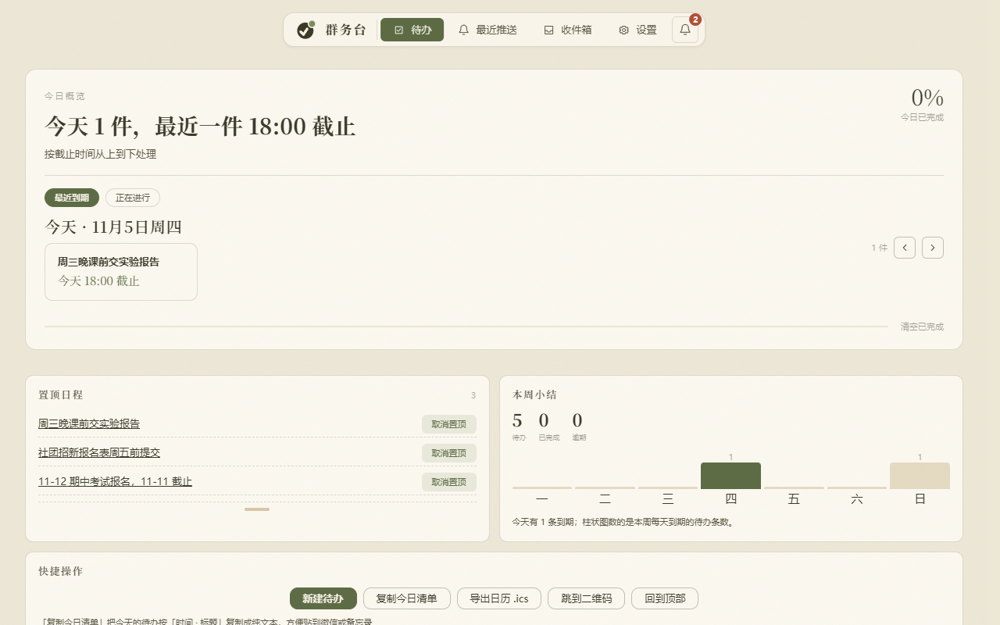
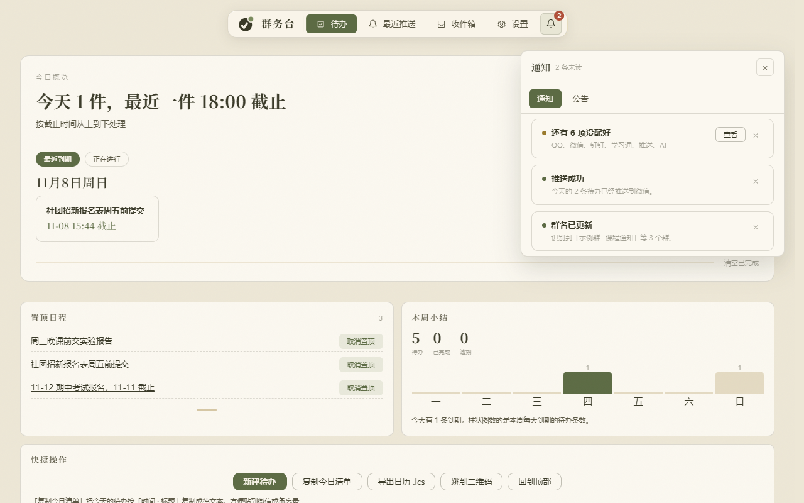
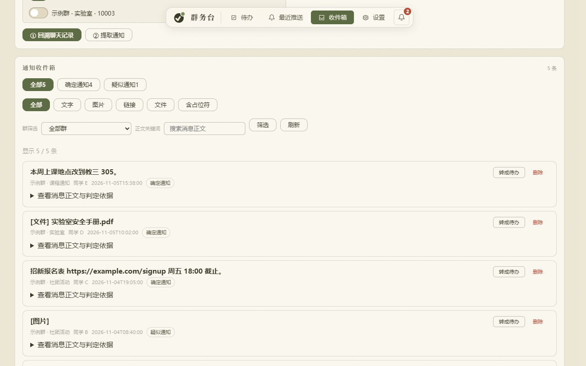
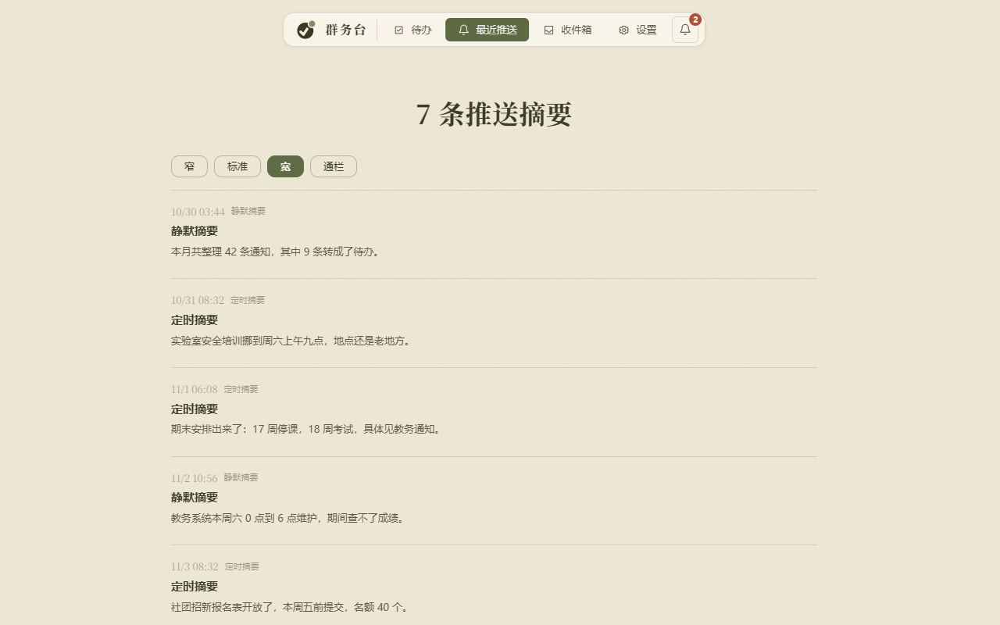
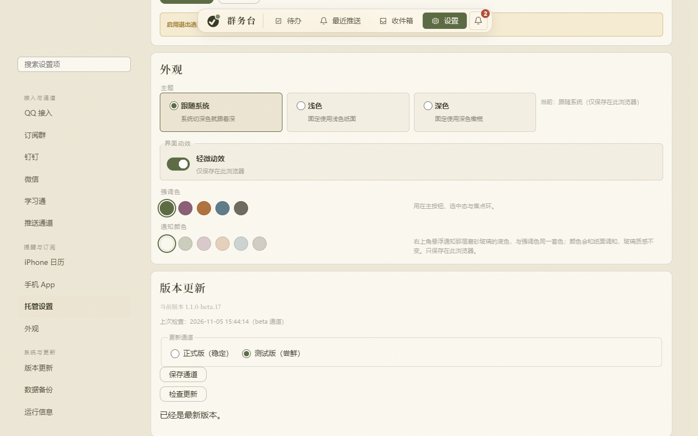
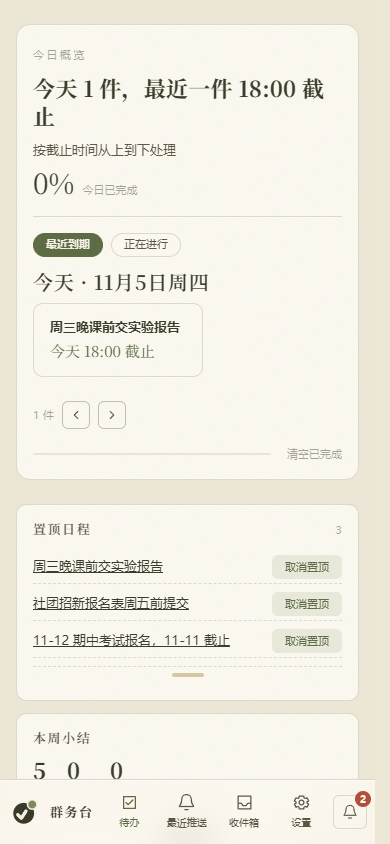
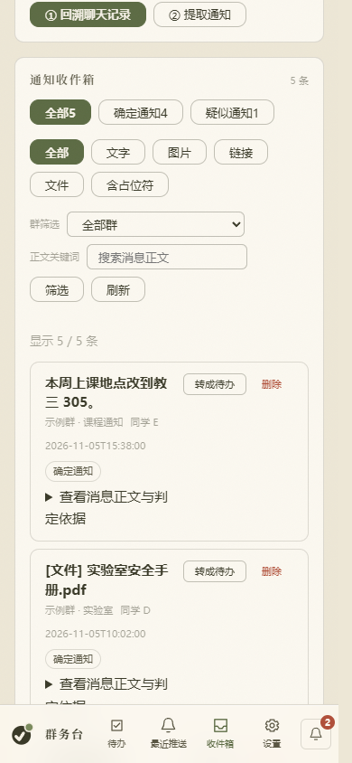
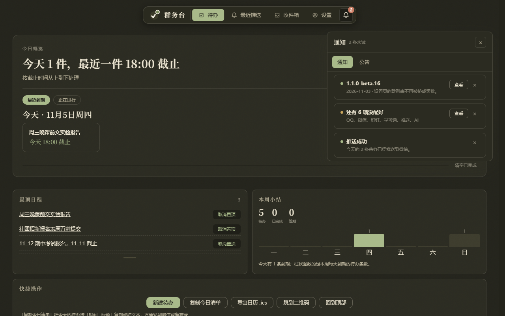

<div align="center">

# 群务台 · notice-hub

**把群里的通知，自动变成待办和日历。**

作业截止、实验报告、社团报名、考试时间——这些消息混在群聊里，翻两屏就找不到了。群务台盯着你指定的几个群（QQ 群、钉钉、微信群、超星学习通都行），把要动手的事挑出来，配上截止时间，摆进一个本地待办台；截止日还能导进手机日历。

[](LICENSE)
[](https://www.python.org/)

[](https://github.com/ExpertKT/notice-hub/actions/workflows/tests.yml)
[](https://github.com/ExpertKT/notice-hub/releases)

[下载正式版 v1.0.0](https://github.com/ExpertKT/notice-hub/releases/tag/v1.0.0) · [下载测试版 v1.1.0-beta.18](https://github.com/ExpertKT/notice-hub/releases/tag/v1.1.0-beta.18) · [使用说明](docs/使用说明.md) · [API 接入](docs/接API.md) · [安卓 App](docs/安卓App.md) · [NapCat 安装](docs/napcat-setup.md)

> **1.1.0 测试版新增**：钉钉群、微信群、学习通跟 QQ 群一起收；待办台、月历、公告面板重做；设置页能一键更新，下载后复算 SHA-256；Linux 也能跑。更早的版本见[更新日志](docs/wiki/changelog.md)。

<p>
  
</p>

</div>

## 它解决什么

老师把实验报告截止时间发在群里，前面是 40 条表情包和接龙。三小时后你想起这件事，得往上翻。

群务台读的是你订阅的那几个群，别的群一条都不碰。它把「需要你动手」的消息挑出来，变成带截止时间的待办，按今天、本周、以后排好；剩下的闲聊留在群里，不进你的列表。

消息、摘要、待办都在你自己的电脑上，一个 SQLite 文件。只有你亲手配过的 AI 或推送通道会看到内容，没有云端账号，也没有遥测。

## 核心能力

- **四个来源**：QQ 群走 NapCat / OneBot v11，钉钉和微信群读本机已有的数据库，学习通走浏览器 Cookie。
- **只看你选的群**：白名单之外的消息不解析、不入库。这是硬规则，不是可调的过滤器。
- **拿不准的不替你决定**：收件箱按 全部 / 文字 / 图片 / 链接 / 文件 / 含占位符 分类，纯 `[图片]` 这类噪声默认折叠，想看再点回来；判不准的标「待确认」，等你一句。
- **待办台**：今天 / 本周 / 以后 / 已完成 四组，能完成、忽略、置顶、稍后提醒。左边一份月历，`.ics` 导出后能订阅进手机系统日历。
- **最近推送**：每天一份定时摘要。正文宽度窄、标准、宽、通栏四档，点一下就换，选择记在本地。
- **右上角铃铛**：通知和公告收进一个面板的两个页签，不再往正文上飘卡片；要求确认的公告不给关闭按钮。
- **推送通道**：QQ 机器人、WxPusher、Server 酱、PushPlus，或者自配 Webhook 发到你自己的 HTTP 端点。
- **手机 App**：扫码配对，是电脑那台服务的外壳。数据留在电脑，手机上只是看。
- **自更新**：Windows 包能检查、下载、安装。下载先试 Gitee 镜像，不通再走 GitHub，装之前复算 SHA-256。

<p align="center">
  
  
</p>

<p align="center">
  
  
</p>

<p align="center">
  
  
  
</p>

## 快速开始

建议让 agent 来装：把这一段发给它，或者让它直接接手这台电脑。

### Windows（推荐）

1. 打开 [Releases](https://github.com/ExpertKT/notice-hub/releases)，下载最新 `QQ-Notice-Hub.zip`。
2. 解压到安装目录，例如 `D:\notice-hub`。目录里要有启动器、服务程序和 `_internal`、`_launcher_internal` 两个运行时目录，别在压缩包里直接双击 exe。
3. 运行 `QQ-Notice-Hub.exe`。Windows 安全提示选「仍要运行」，防火墙提示允许专用网络，然后按网页向导配置接入。

默认地址 <http://127.0.0.1:8766/>。

### 手机 App

1. 在同一个 Releases 页面下载 `notice-hub-android-*.apk`（安卓端本轮没改动，与 beta.1 是同一份）。
2. 电脑端「设置 → 手机 App」会显示二维码，用 App 扫一下，地址和配对信息自动填好。
3. 扫不动就改用同一块里的 6 位数字配对码手输。
4. 手机和电脑连同一个 Wi-Fi 最省事；要用流量，先在设置里开通公网地址或让两端都连同一个 Tailscale。

### Linux（Ubuntu / Debian）

```bash
git clone https://github.com/ExpertKT/notice-hub.git ~/notice-hub
cd ~/notice-hub
bash packaging/linux/install.sh
```

装的是用户级 systemd 服务，NapCat 需要自己跑（Docker 或本机），Linux 没有托盘。详见 [Linux 部署说明](docs/linux.md)。macOS 暂未适配（`packaging/macos/` 下的脚本保留但未验证）。

### 从源码跑

```powershell
git clone https://github.com/ExpertKT/notice-hub.git
cd notice-hub
python -m venv .venv
.\.venv\Scripts\python.exe -m pip install -r requirements.txt
Copy-Item .env.example .env
.\.venv\Scripts\python.exe main.py doctor   # 检查配置和依赖
.\.venv\Scripts\python.exe main.py run      # 启动服务
```

## 平台差异

| 能力 | Windows | Linux |
| --- | --- | --- |
| 安装方式 | 出货包（双击） | 源码 + `install.sh`（systemd user） |
| 网页界面 / 推送通道 | ✅ | ✅ |
| QQ（NapCat）接入 | ✅ 内置一键接入 | ✅ 自行部署 NapCat |
| 系统托盘 | ✅ | ❌ |
| 应用内自动更新 | ✅ 检查 + 下载 + 安装 | ❌ |
| 读本机微信 / 钉钉数据库 | ✅ | ❌ |
| 学习通 Cookie 自动读取 | ✅ | ❌ 需手动粘贴 |

带 ❌ 的几项依赖 Windows 的系统接口（DPAPI、进程内存、注册表），是平台机制不同，不是没适配。

## 配置速查

建议让 agent 来装：把这一段发给它，或者让它直接接手这台电脑。

从 `.env.example` 复制 `.env`。完整字段见 `.env.example` 与 `docs/`。

| 变量 | 作用 |
| --- | --- |
| `QQ_DIGEST_GROUPS` | 要监控的群号，逗号分隔；留空则不处理群消息 |
| `QQ_DIGEST_ONEBOT_TOKEN` | 与 NapCat OneBot HTTP 配置一致 |
| `QQ_DIGEST_WEB` | 是否启用网页待办台 |
| `QQ_DIGEST_WEB_PORT` | 网页端口，默认 `8766` |
| `QQ_DIGEST_WEB_BASE_URL` | 公网入口，手机和推送链接用 |
| `WXPUSHER_APP_TOKEN` / `WXPUSHER_UIDS` | WxPusher 推送（可选） |
| `QQ_DIGEST_LLM_API_KEY` | 可选模型 Key（旧名 `DASHSCOPE_API_KEY` 仍兼容）；不填走本地规则摘要 |

## 常见问题

<details>
<summary><b>连接检查失败 / 由于目标计算机积极拒绝（10061）</b></summary>

NapCat 没跑，或者端口不对。点「一键接入」或「启动并登录」，用手机 QQ 扫码，登录后刷新检测。

</details>

<details>
<summary><b>群里发了通知，网页里没有</b></summary>

先确认这个群在订阅白名单里并已保存，再去收件箱看「待确认」分组。程序停机期间只补采最近 24 小时的消息。

</details>

<details>
<summary><b>二维码过期 / 想换一张</b></summary>

点「刷新二维码」会让 NapCat 重新出码并加载新图，不再只是重新下载同一张。NapCat 是第三方 QQ 协议客户端，登录主号有风控风险；本项目只读群消息，用不用小号自己判断。

</details>

<details>
<summary><b>手机连不上 / 订阅打不开</b></summary>

局域网地址只在同一网络下有效。手机用流量时，在设置里开通公网地址（需要你在 Tailscale 的浏览器登录页登一次，这一步替不了），或者让两端都连同一个 Tailscale。没开通时只有局域网地址。

</details>

<details>
<summary><b>用了模型，但摘要退回本地规则</b></summary>

模型请求失败会自动回退，界面会显示回退原因。检查 `QQ_DIGEST_LLM_API_KEY`、余额和网络；不想用模型就把 Key 留空。

</details>

## 隐私与安全

- 数据默认只在本机：SQLite、附件缓存、日志都在安装目录下，没有云端同步。
- 页面访问需要令牌，首次打开会用地址里的令牌换 HttpOnly 会话 Cookie，然后把它从地址栏抹掉。
- 更新包只认 GitHub / Gitee 下载域名，清单必须带 sha256，安装脚本先复算哈希再解压。
- 数据库启动时做完整性检查，真损坏就隔离成 `.corrupt-<时间戳>` 再重建，并每天快照保留 7 份。
- 提交 Issue 或截图前，请打码 QQ 号、群号、域名、本机路径和消息内容；不要提交 `.env`、日志、数据库或任何含 Token 的文件。

## 已知限制

- NapCat / 电脑端服务必须运行并保持登录才能实时接收，停机期间依赖历史补采。
- Linux 是源码服务模式，更新包要手动安装；手机 App 只是电脑端的外壳。
- 没有官方 API 的来源（学习通、课堂派这类）靠网页接口，改版时可能失效，需要跟着修。

## 开发

子命令：`run`、`tick`、`preview`、`stats`、`show`、`tasks`、`catchup`、`doctor`、`send-test`、`attach-test`。

```powershell
.\.venv\Scripts\python.exe -m unittest discover -s tests -t .   # 全量测试
.\packaging\build.ps1                                          # Windows 出货包
```

| 路径 | 作用 |
| --- | --- |
| `noticehub/receiver.py` | 接收 NapCat OneBot v11 上报 |
| `noticehub/store.py` | SQLite 存储、去重、收件箱与恢复 |
| `noticehub/summarizer.py` | 提取待办、截止时间、推送文本 |
| `noticehub/push.py` | 推送通道与失败回退 |
| `noticehub/service.py` | 调度、补采、重试与生命周期 |
| `noticehub/webapp.py` | 待办台、月历、收件箱、设置页 |
| `noticehub/napcat_admin.py` | NapCat 探测、启停、配置、登录二维码 |
| `packaging/launcher.py` | 出货包启动器、托盘、单实例互斥 |
| `main.py` | CLI 入口 |

安卓工程用 Gradle（JDK 17 + Android SDK 35），细节见 [docs/安卓App.md](docs/安卓App.md)。改动记录在 [docs/wiki/changelog.md](docs/wiki/changelog.md)。

## License

个人与非商业使用免费；商业使用请联系 jkl2755908073@qq.com 获取授权。详见 [LICENSE](LICENSE)。

---

<div align="center">

# notice-hub

**Turn group chat into a to-do list and a calendar.**

Reads QQ groups, DingTalk, WeChat groups and Chaoxing (超星学习通), drops the chatter, and pulls out notices, action items and deadlines into one local task board you can also subscribe to from your phone.

> **New in 1.1.0 (beta)**: DingTalk, WeChat groups and Chaoxing join QQ; the task board, calendar and announcement panel were rebuilt; one-click self-update with a SHA-256 check; Linux installs. Older releases are in the [changelog](docs/wiki/changelog.md).

</div>

## What it is

Homework, lab reports, sign-ups and exam dates live in five different group chats. notice-hub reads only the groups you pick, keeps what needs action, and files it by today / this week / later with a deadline. Everything is stored in one SQLite file on your own machine — no cloud account, no telemetry.

## Features

- **Four sources**: QQ groups (NapCat / OneBot v11), DingTalk, WeChat groups, and Chaoxing. The first three read local databases or OneBot reports; Chaoxing uses a browser cookie.
- **Allow-list only**: groups outside your subscription list are never processed.
- **Noise control**: an inbox with type filters (all / text / image / link / file / placeholder). Bare `[图片]` placeholders are folded by default.
- **Task board**: grouped by today / this week / later / done, with complete, ignore, pin and snooze; plus a month calendar and an `.ics` feed for your phone.
- **Daily digest**: four reading widths (narrow / standard / wide / full), remembered locally.
- **Notification bell**: one popover with *Notifications* and *Announcements* tabs, instead of cards floating over the page.
- **Push channels**: QQ bot, WxPusher, ServerChan, PushPlus, or any HTTP webhook.
- **Android app**: pairs by QR code; it is a shell around the desktop service, so data stays on the computer.
- **Self-update**: on Windows it checks, downloads, verifies SHA-256 and installs; Gitee mirror first, GitHub as fallback.

## Quick start (Windows)

Easier: hand this section to an agent and let it do the install for you.

1. Download the latest `QQ-Notice-Hub.zip` from [Releases](https://github.com/ExpertKT/notice-hub/releases).
2. Unzip it to a folder such as `D:\notice-hub`. Keep the launcher, the service exe and the `_internal` / `_launcher_internal` folders together.
3. Run `QQ-Notice-Hub.exe`, allow it on private networks if Windows Firewall asks, then follow the in-page wizard.

Then open <http://127.0.0.1:8766/>.

Linux runs from source with `bash packaging/linux/install.sh` (user-level systemd, no tray). See [Linux](docs/linux.md) notes. macOS is not adapted yet (install scripts kept, unverified).

## How it works

NapCat reports QQ group messages over OneBot v11. DingTalk and WeChat are read from their local databases on Windows. Chaoxing is polled with a cookie. Everything is normalised into one SQLite store, filtered against your group allow-list, then turned into tasks by local rules or an optional model. When the model fails, rules take over.

## Privacy

Data stays local: SQLite, attachment cache and logs live in the install folder. The web page exchanges the URL token for an HttpOnly session cookie and then drops it from the address bar. Update packages are only accepted from GitHub / Gitee download domains and are verified against a signed manifest before extraction.

## Known limits

- NapCat and the desktop service must stay running and logged in for live reception.
- Linux only checks and downloads updates; installing is manual.
- Sources without an official API (Chaoxing and similar) can break when the vendor changes its web endpoints.

## License

Free for personal and non-commercial use. Commercial use: contact jkl2755908073@qq.com. See [LICENSE](LICENSE).
