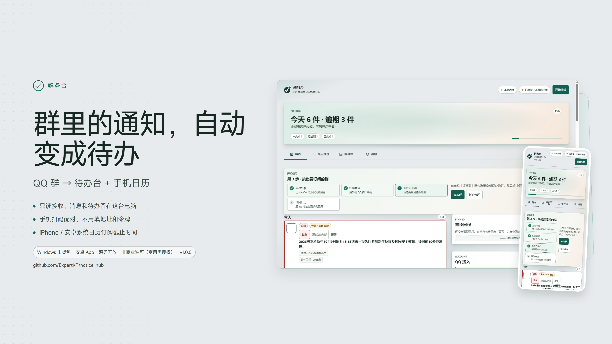
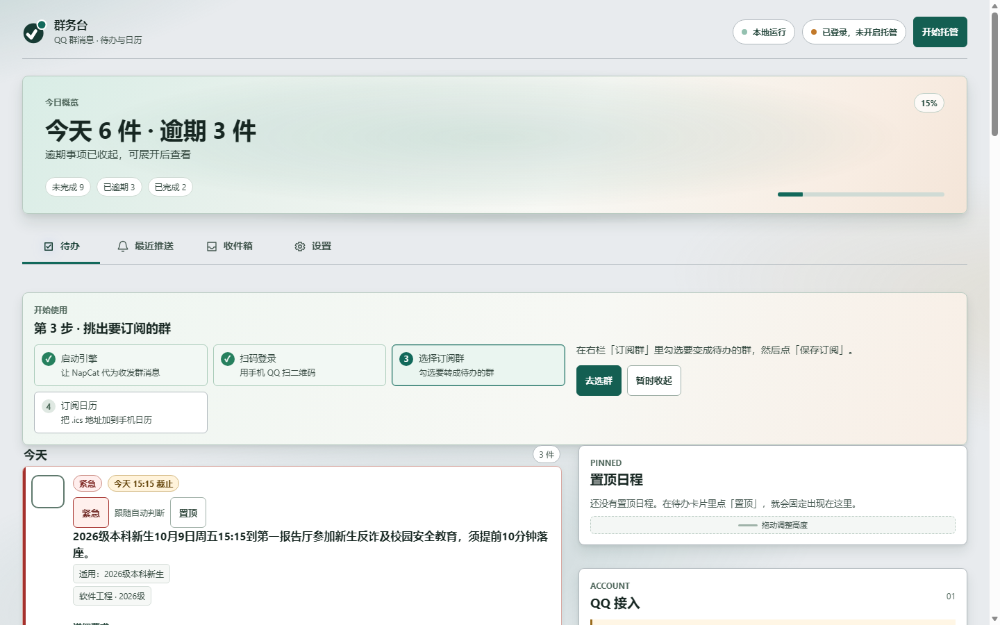

<div align="center">

# 群务台 · notice-hub

**把 QQ 群里的通知，自动变成待办和日历。**

从指定 QQ 群读取消息，过滤闲聊，提取通知、行动项和截止时间，集中到网页待办台，也可订阅手机日历。

[](LICENSE)
[](https://www.python.org/)

[](https://github.com/ExpertKT/notice-hub/actions/workflows/tests.yml)
[](https://github.com/ExpertKT/notice-hub/releases)

[下载正式版 v1.0.0](https://github.com/ExpertKT/notice-hub/releases/tag/v1.0.0) · [下载测试版 v1.1.0-beta.2](https://github.com/ExpertKT/notice-hub/releases/tag/v1.1.0-beta.2) · [使用说明](docs/使用说明.md) · [API 接入](docs/接API.md) · [安卓 App](docs/安卓App.md) · [NapCat 安装](docs/napcat-setup.md)

**🧪 v1.1.0 测试版（beta.2）已发布 — [查看说明并下载 →](https://github.com/ExpertKT/notice-hub/releases/tag/v1.1.0-beta.2)**

钉钉群、学习通、微信群也能收了；网页顶部重排、测试版换成琥珀色 logo，自检和月历的几处毛病也修了。<br>
这是**预发布版**，稳定版仍是 [v1.0.0](https://github.com/ExpertKT/notice-hub/releases/tag/v1.0.0)；稳定版用户不会被自动升级到测试版。

<a href="https://github.com/ExpertKT/notice-hub/releases/tag/v1.1.0-beta.2">
  
</a>

</div>

<p align="center">
  
</p>

## 适合谁

如果作业、实验、报名和考试时间散在多个 QQ 群里，群务台会把需要你行动的内容集中到一个页面。消息、摘要和待办默认只存在你这台电脑上；只有你自己配的 AI 或推送通道会看到内容。

## 核心能力

- 只收你勾选的群；闲聊自动降噪，拿不准的消息先让你确认，再进待办。
- 待办按今天、本周、以后、已完成分组，支持完成、忽略、置顶和稍后提醒。
- 网页上有月历；也能把日程订阅进 iPhone 或安卓自带的日历，到点手机会自己响。
- 截止提醒、紧急事项直达；提醒能送到微信、钉钉、企业微信、飞书，也可以直接私聊到你的 QQ。
- PDF、Word、Excel、PPT、文本、压缩包和截图可解析，原文可回溯。
- 设置页点一下就能装好 QQ 接入组件、勾选要订阅的群，扫码成功后页面会自动刷新。
- 设置页能检查更新并按通道升级（正式版 / 测试版）；测试版不会推给正式版用户。
- 手机 App 支持扫码配对；电脑端不再弹黑窗，安装包双击即用。
- 出门在外也能用：设置里能开通公网地址，或者用 Tailscale 把电脑和手机连成一张网。

## 快速开始

### 方式一：交给 AI 装（最推荐）

群务台装在 Windows 上，安装本身只是下载、解压、双击三步。把它交给手边的 AI 去做最省事：它下载、解压、启动、处理防火墙提示，你只在扫码那一步拿出手机。

把下面这段整段复制，发给任意一个 AI（DeepSeek、ChatGPT、Claude、豆包都行；Cursor、Trae 这类写代码的工具也可以）：

> 帮我安装群务台：https://github.com/ExpertKT/notice-hub
> 按它的 README 操作：从 Releases 里下载最新的 QQ-Notice-Hub.zip，解压到一个不在 C 盘、路径里没有空格的文件夹，双击 QQ-Notice-Hub.exe 启动。如果 Windows 弹防火墙提示，允许「专用网络」。装好后告诉我下一步怎么做。

它装完会告诉你接下来点什么。你只需要在页面上点「启动引擎」，然后拿手机 QQ 扫屏幕上的二维码。

### 方式二：自己装（四步，大约五分钟）

1. 打开 [Releases](https://github.com/ExpertKT/notice-hub/releases)，找到日期最新的一条，点里面的 `QQ-Notice-Hub.zip` 下载。
2. 右键这个压缩包 →「全部解压缩」→ 选一个不在 C 盘的位置，比如 `D:\notice-hub`。
   **别直接在压缩包里双击 exe**，那样每次打开都要重新解压一遍。
3. 打开解压出来的文件夹，双击 `QQ-Notice-Hub.exe`。
   - 如果弹出「Windows 已保护你的电脑」：点「更多信息」→「仍要运行」。
   - 如果弹出防火墙提示：勾上「专用网络」，点「允许访问」。这一步关系到手机能不能连上电脑。
4. 浏览器会自动打开群务台的页面。跟着页面上那四个步骤走：**启动引擎 → 扫码登录 → 选群 → 订阅日历**。

装好之后桌面会出现「群务台」的快捷方式，以后从这里打开就行。

### 方式三：装到手机上

1. 在同一个 [Releases](https://github.com/ExpertKT/notice-hub/releases) 页面，下载 `notice-hub-android-*.apk`，传到手机上安装（安卓端本轮没有改动，与 beta.1 是同一份）。
2. 电脑端页面打开「设置」，找到「手机 App」那一块，屏幕上会出现一个二维码。
3. 用手机 App 扫这个二维码，地址和配对信息会自动填好。
4. 二维码扫不动时，改用那一块里的 **6 位数字配对码**，手输进 App 即可。
5. 手机和电脑连同一个 Wi-Fi 最省事；手机用流量时，先在电脑端设置里开通公网地址，或者让两端都连上同一个 Tailscale。

App 只是电脑端服务的外壳，消息和待办仍然存在电脑上；想自己编译见 [docs/安卓App.md](docs/安卓App.md)。

### 方式四：从源码跑（开发者）

```powershell
git clone https://github.com/ExpertKT/notice-hub.git
cd notice-hub
python -m venv .venv
.\.venv\Scripts\python.exe -m pip install -r requirements.txt
Copy-Item .env.example .env
.\.venv\Scripts\python.exe main.py doctor
.\.venv\Scripts\python.exe main.py run
```

`doctor` 先检查配置和依赖，`run` 启动服务（默认待办台端口为 8766）。

## 配置速查

从 `.env.example` 复制 `.env`。首页只列高频项，完整说明请看 `.env.example` 和 `docs/`。

| 变量 | 作用 |
| --- | --- |
| `QQ_DIGEST_GROUPS` | 要监控的群号，逗号分隔；留空则不处理群消息 |
| `QQ_DIGEST_ONEBOT_TOKEN` | 与 NapCat OneBot HTTP 配置一致 |
| `QQ_DIGEST_WEB` | 是否启用网页待办台 |
| `QQ_DIGEST_WEB_PORT` | 网页端口，默认 `8766` |
| `QQ_DIGEST_WEB_BASE_URL` | 公网入口，供手机和推送链接使用 |
| `WXPUSHER_APP_TOKEN` | WxPusher 应用 Token（可选） |
| `WXPUSHER_UIDS` | WxPusher 接收人（可选） |
| `QQ_DIGEST_LLM_API_KEY` | 可选模型 Key（旧名 `DASHSCOPE_API_KEY` 仍兼容）；不填则使用本地规则摘要 |

## 开发者

### 模块

| 文件 | 作用 |
| --- | --- |
| `qq_digest.py` | 消息过滤与摘要入口 |
| `qq_live_digest/receiver.py` | 接收 NapCat OneBot v11 上报 |
| `qq_live_digest/store.py` | SQLite 存储、去重和恢复 |
| `qq_live_digest/summarizer.py` | 提取待办、截止时间和推送文本 |
| `qq_live_digest/push.py` | 推送通道与失败回退 |
| `qq_live_digest/service.py` | 调度、补采、重试和服务生命周期 |
| `qq_live_digest/webapp.py` | 待办台、月历、收件箱和设置页 |
| `qq_live_digest/napcat_admin.py` | NapCat 探测、启停、配置和登录二维码 |
| `qq_live_digest/hosting.py` | QQ/NapCat 托管切换与状态持久化 |
| `packaging/launcher.py` | 出货包启动器、托盘和单实例互斥 |
| `main.py` | CLI 入口 |

### 命令与测试

`main.py` 当前注册的子命令：`run`、`tick`、`preview`、`stats`、`show`、`tasks`、`catchup`、`doctor`、`send-test`、`attach-test`。

```powershell
# 全量测试（数字随改动增长，不在此写死）
.\.venv\Scripts\python.exe -m unittest discover -s tests -t .

# Windows 出货包
.\packaging\build.ps1
```

Android 工程使用 Gradle，构建环境为 **JDK 17 + Android SDK 35**。发布时打 tag，再执行 `gh release create` 上传出货包和 APK。

## 常见问题

<details>
<summary><b>连接检查失败 / 由于目标计算机积极拒绝（10061）</b></summary>

NapCat 或目标端口尚未运行。点「一键接入」或「启动并登录」，用手机 QQ 扫码，登录后刷新检测。

</details>

<details>
<summary><b>订阅读不到 / Failed to fetch</b></summary>

局域网地址只对同一网络有效。手机使用流量时，在设置页开通公网地址或配置 Tailscale，并重新复制带配对信息的订阅地址。

</details>

<details>
<summary><b>群里发了通知，网页没有</b></summary>

确认群在订阅白名单并已保存；再检查「待确认」分组。关机期间只补采最近 24 小时消息。

</details>

<details>
<summary><b>二维码过期 / 主号风控</b></summary>

登录二维码由 NapCat 自己每隔一段时间换新，点「刷新二维码」只是立刻重取当前那张；想立刻换一张就点「重启引擎」再扫。订阅二维码的内容是订阅地址本身，地址没变码就不会变，所以设置里的「刷新二维码」会在没变时直接告诉你「订阅地址没变」。NapCat 是第三方 QQ 协议客户端，登录主号有风控风险；本项目只读群消息，是否使用小号请自行判断。

</details>

## 隐私与安全

不要提交 `.env`、日志、SQLite、附件缓存或任何含 Token、UID、API Key 的文件。提交 Issue 和截图前，请打码 QQ 号、群号、域名、本机路径与消息内容。若密钥泄露，应立即作废并重新生成。

## 已知限制

- NapCat 和电脑端服务必须运行并保持登录，才能实时接收；关机期间依赖历史补采。
- 安装包只支持 Windows；Android App 是电脑端服务的手机客户端。
- 摘要默认由本地规则生成；可选模型失败时会自动回退。

基于上游 [wc985732-lang/qq-live-digest](https://github.com/wc985732-lang/qq-live-digest) 二次开发。上游部分及其派生部分适用 MIT；本人新增部分适用 PolyForm Noncommercial 1.0.0。

## License

个人与非商业使用免费；商业使用请联系 jkl2755908073@qq.com 获取授权。详见 [LICENSE](LICENSE)、[LICENSE-UPSTREAM](LICENSE-UPSTREAM) 与 [NOTICE](NOTICE)。
